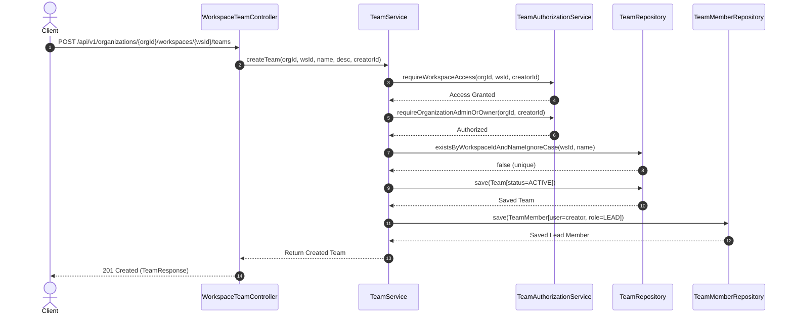
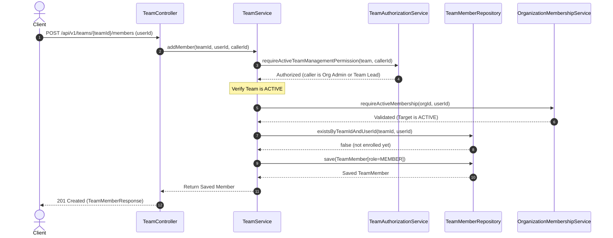
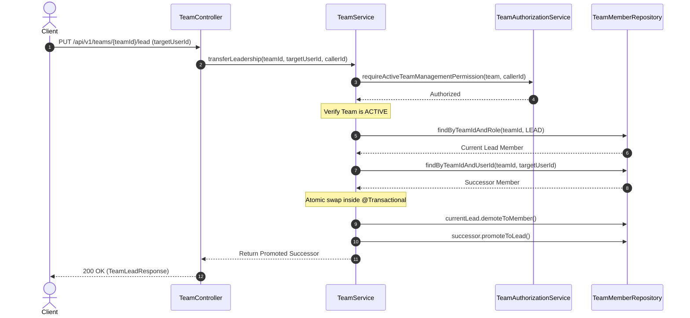
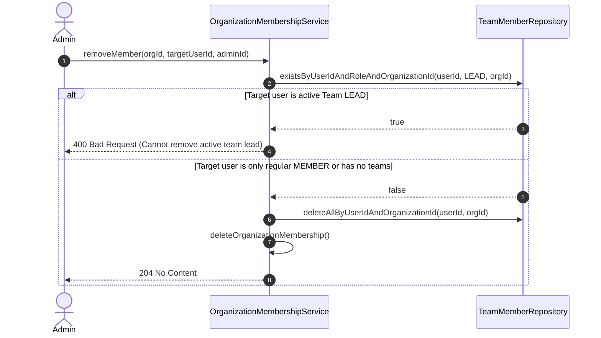

# DevFlow — Teams REST API Specification & Guidelines

> **Version:** 1.0.0  
> **Status:** Final / Architecture Review Board (ARB) Approved  
> **Module:** Phase 2.6 — Engineering Teams (`com.devflow.team`)  
> **Classification:** Internal & Partner Engineering  
> **Last Updated:** 2026-11-01  

---

## Table of Contents

1. [Module Overview & Bounded Context](#1-module-overview--bounded-context)
2. [Domain Model & Invariants](#2-domain-model--invariants)
   - 2.1 [Resource Hierarchy](#21-resource-hierarchy)
   - 2.2 [Team Roles & Statuses](#22-team-roles--statuses)
   - 2.3 [The Single-Lead Invariant](#23-the-single-lead-invariant)
   - 2.4 [Workspace Visibility & Precedence](#24-workspace-visibility--precedence)
   - 2.5 [Organization Lifecycle Integration](#25-organization-lifecycle-integration)
   - 2.6 [Archived Immutability](#26-archived-immutability)
3. [Security & Authorization Model](#3-security--authorization-model)
   - 3.1 [Authentication & Principal Resolution](#31-authentication--principal-resolution)
   - 3.2 [Authorization Matrix](#32-authorization-matrix)
4. [Error Contract & Standard Responses](#4-error-contract--standard-responses)
   - 4.1 [Standard Error Response Envelope](#41-standard-error-response-envelope)
   - 4.2 [HTTP Status Code Semantics](#42-http-status-code-semantics)
   - 4.3 [Error Response Examples](#43-error-response-examples)
5. [Workspace-Scoped Endpoint Reference](#5-workspace-scoped-endpoint-reference)
   - 5.1 [Create Team](#51-create-team)
   - 5.2 [List Teams in Workspace](#52-list-teams-in-workspace)
   - 5.3 [Get Team in Workspace](#53-get-team-in-workspace)
6. [Resource-Scoped Endpoint Reference](#6-resource-scoped-endpoint-reference)
   - 6.1 [Get Team Details](#61-get-team-details)
   - 6.2 [Update Team](#62-update-team)
   - 6.3 [Archive Team](#63-archive-team)
   - 6.4 [Add Team Member](#64-add-team-member)
   - 6.5 [List Team Members](#65-list-team-members)
   - 6.6 [Remove Team Member](#66-remove-team-member)
   - 6.7 [Leave Team](#67-leave-team)
   - 6.8 [Get Team Lead](#68-get-team-lead)
   - 6.9 [Transfer Team Leadership](#69-transfer-team-leadership)
7. [Sequence Diagrams & Lifecycle Workflows](#7-sequence-diagrams--lifecycle-workflows)
   - 7.1 [Team Creation & Initial Lead Assignment Flow](#71-team-creation--initial-lead-assignment-flow)
   - 7.2 [Team Member Addition Flow](#72-team-member-addition-flow)
   - 7.3 [Atomic Leadership Transfer Flow](#73-atomic-leadership-transfer-flow)
   - 7.4 [Organization Member Removal & Lead Safeguard Flow](#74-organization-member-removal--lead-safeguard-flow)

---

## 1. Module Overview & Bounded Context

The **Teams** module (`com.devflow.team`) introduces first-class collaborative units into DevFlow. While Organizations define the legal multi-tenant boundary and Workspaces partition projects and resources, Teams model functional groups of engineers (e.g., *Frontend Core*, *Platform SRE*, *AI Engine*) working within workspaces.

### Architectural Tenets
1. **Multi-Tenant Boundary:** An Organization is the strict tenant isolation boundary. A team cannot span multiple organizations, and users must belong to the organization before participating in any team.
2. **Workspace Containment:** Every team belongs to exactly one workspace (`workspace_id` + `organization_id` foreign key). Teams cannot exist independently of a workspace.
3. **Dual Scoping Model:**
   - **Workspace-Scoped URIs:** Used for collection operations (`POST` to create, `GET` to list, `GET` within workspace boundary).
   - **Resource-Scoped URIs:** Conforms to DevFlow's strict **two-level URI nesting limit** (per `docs/api/API_STANDARDS.md` §4). Sub-resources like members and leadership are promoted to `/api/v1/teams/{teamId}/**`.
4. **Stateless Security:** Client requests must provide an authorized Bearer JWT. The caller identity is derived strictly from the verified security context (`AuthenticationPrincipal`); clients are never trusted to specify the acting user in request payloads.

---

## 2. Domain Model & Invariants

### 2.1 Resource Hierarchy

```
Organization (Tenant Boundary)
  └── Workspace (Visibility Boundary: PUBLIC | PRIVATE)
        └── Team (Functional Boundary: ACTIVE | ARCHIVED)
              └── TeamMember (Role: LEAD | MEMBER)
```

- **Organization:** Root boundary.
- **Workspace:** Child of Organization.
- **Team:** Child of Workspace and Organization.
- **TeamMember:** Bridge entity linking an authenticated `User` to a `Team`.

### 2.2 Team Roles & Statuses

#### Team Roles (`TeamRole`)
| Role | Description |
| :--- | :--- |
| `LEAD` | The designated single leader of the team. Possesses administrative control over team metadata, member management, and leadership handover. |
| `MEMBER` | A standard member of the team. Can view team resources, collaborate, and voluntarily leave the team. |

#### Team Statuses (`TeamStatus`)
| Status | Description |
| :--- | :--- |
| `ACTIVE` | Fully operational. Members can be added/removed, metadata updated, and leadership transferred. |
| `ARCHIVED` | Soft-deleted / terminal state. Read-only. No mutations permitted on team attributes or memberships. |

### 2.3 The Single-Lead Invariant

Every active team **must have exactly one active lead** at all times:
- **Creation:** The creator of the team is automatically assigned the `LEAD` role upon creation.
- **Atomic Transfer:** Changing leadership is executed via `PUT /api/v1/teams/{teamId}/lead`, which atomically demotes the current lead to `MEMBER` and promotes the chosen member to `LEAD`.
- **Non-Vacatable:** A lead cannot be removed (`DELETE /api/v1/teams/{teamId}/members/{userId}`) or voluntarily leave (`POST /api/v1/teams/{teamId}/leave`) without first transferring leadership to another team member.
- **No Direct Demotion:** A lead cannot be demoted directly without a designated successor.

### 2.4 Workspace Visibility & Precedence

Teams inherit visibility constraints from their parent Workspace:
- **`PUBLIC` Workspaces:** Any active member of the tenant Organization can view teams, list members, and inspect team leads.
- **`PRIVATE` Workspaces:** Only Organization `OWNER` or `ADMIN` roles can view or manage teams within the workspace. Private workspace visibility **strictly overrides** team membership—if a user is a team member but lacks org admin/owner privileges in a private workspace, access is denied (`403 Forbidden`).

### 2.5 Organization Lifecycle Integration

Team membership is directly governed by Organization membership lifecycle:
- **Active Membership Required:** Only users with `OrganizationMembershipStatus.ACTIVE` can be added to teams or perform team operations.
- **Suspended Members:** If an organization member is suspended (`SUSPENDED`), their team membership record remains, but they are forbidden from performing any team actions (`403 Forbidden`).
- **Suspended Lead Safeguard:** If a team lead's organization membership is suspended, an Organization `ADMIN` or `OWNER` can transfer leadership away from the suspended lead to restore active operational leadership.
- **Member Removal Safeguards:** When an organization member is removed:
  - If the user is an active `LEAD` of any team, the organization member removal is blocked (`400 Bad Request` / `IllegalStateException`) until leadership is transferred.
  - If the user is a `MEMBER` of teams, their team memberships are automatically cleaned up in cascade.

### 2.6 Archived Immutability

Archiving a team transitions its status to `ARCHIVED`. Once archived:
- The team becomes strictly **read-only**.
- Metadata updates (`PATCH /api/v1/teams/{teamId}`) return `400 Bad Request`.
- Member mutations (`POST /api/v1/teams/{teamId}/members`, `DELETE /api/v1/teams/{teamId}/members/{userId}`, `POST /api/v1/teams/{teamId}/leave`) return `400 Bad Request`.
- Leadership transfer (`PUT /api/v1/teams/{teamId}/lead`) returns `400 Bad Request`.
- Re-archiving (`POST /api/v1/teams/{teamId}/archive`) returns `400 Bad Request`.

---

## 3. Security & Authorization Model

### 3.1 Authentication & Principal Resolution

All Teams endpoints require an HTTP `Authorization` header containing a valid Bearer JWT:
```http
Authorization: Bearer <valid_jwt_token>
```
The application extracts the caller's identity via Spring Security's `@AuthenticationPrincipal DevFlowUserDetails`. Under no circumstances can a caller specify or spoof their own user ID in the request payload.

### 3.2 Authorization Matrix

| Operation | Org Owner | Org Admin | Team Lead | Team Member | Non-Member Org Member | Suspended Member | Unauthenticated |
| :--- | :---: | :---: | :---: | :---: | :---: | :---: | :---: |
| **Create Team** | Allowed | Allowed | N/A | Denied (403) | Denied (403) | Denied (403) | Unauthorized (401) |
| **List Teams in Workspace** | Allowed | Allowed | Allowed* | Allowed* | Allowed* | Denied (403) | Unauthorized (401) |
| **Get Team Details** | Allowed | Allowed | Allowed* | Allowed* | Allowed* | Denied (403) | Unauthorized (401) |
| **Update Team** | Allowed | Allowed | Allowed | Denied (403) | Denied (403) | Denied (403) | Unauthorized (401) |
| **Archive Team** | Allowed | Allowed | Allowed | Denied (403) | Denied (403) | Denied (403) | Unauthorized (401) |
| **Add Team Member** | Allowed | Allowed | Allowed | Denied (403) | Denied (403) | Denied (403) | Unauthorized (401) |
| **List Team Members** | Allowed | Allowed | Allowed* | Allowed* | Allowed* | Denied (403) | Unauthorized (401) |
| **Remove Team Member** | Allowed | Allowed | Allowed | Denied (403) | Denied (403) | Denied (403) | Unauthorized (401) |
| **Leave Team** | Denied if Lead | Denied if Lead | Denied if Lead | Allowed | N/A (404) | Denied (403) | Unauthorized (401) |
| **Get Team Lead** | Allowed | Allowed | Allowed* | Allowed* | Allowed* | Denied (403) | Unauthorized (401) |
| **Transfer Leadership** | Allowed | Allowed | Allowed | Denied (403) | Denied (403) | Denied (403) | Unauthorized (401) |

*\*Subject to Workspace Visibility rules: If the parent workspace is `PRIVATE`, non-admin members receive `403 Forbidden`.*

---

## 4. Error Contract & Standard Responses

### 4.1 Standard Error Response Envelope

All error responses from the Teams module adhere strictly to the platform standard defined in `docs/api/ERROR_RESPONSE_FORMAT.md`:

```json
{
  "timestamp": "2026-11-01T00:30:00.123Z",
  "status": 400,
  "error": "Bad Request",
  "message": "Team name cannot be blank",
  "path": "/api/v1/organizations/550e8400-e29b-41d4-a716-446655440000/workspaces/550e8400-e29b-41d4-a716-446655440001/teams"
}
```

> **OpenAPI Schema Component:** In the published OpenAPI specification (`/v3/api-docs`), this standard JSON error structure is registered under `#/components/schemas/ErrorResponse` with media type `application/json` across all HTTP 4xx response codes.

#### Fields Description
- `timestamp` *(string, ISO-8601 UTC)*: The exact time the error was generated by the backend.
- `status` *(integer)*: Standard HTTP status code (e.g., `400`, `401`, `403`, `404`, `409`).
- `error` *(string)*: Standard HTTP status reason phrase (e.g., `"Bad Request"`, `"Forbidden"`, `"Not Found"`).
- `message` *(string)*: Clear, human-readable description of the domain error or validation failure.
- `path` *(string)*: The requested URI path that produced the error.

### 4.2 HTTP Status Code Semantics

| HTTP Status | Exception Origin | Description / Typical Trigger |
| :--- | :--- | :--- |
| **`400 Bad Request`** | `MethodArgumentNotValidException`, `InvalidTeamOperationException`, `IllegalArgumentException` | Malformed JSON, missing/blank fields, name exceeding 100 chars, description exceeding 500 chars, modifying an archived team, lead attempting to leave without transfer, or target user is suspended. |
| **`401 Unauthorized`** | `JwtAuthenticationEntryPoint` | Missing, malformed, or expired Bearer JWT token. |
| **`403 Forbidden`** | `TeamAccessDeniedException`, `WorkspaceAccessDeniedException` | Caller lacks required role (e.g., non-admin attempting to create a team, access a private workspace, or update team attributes). |
| **`404 Not Found`** | `TeamNotFoundException`, `TeamMemberNotFoundException`, `WorkspaceNotFoundException` | Specified organization, workspace, team, or membership record does not exist or does not match tenancy boundary. |
| **`409 Conflict`** | `TeamAlreadyExistsException`, `TeamMemberAlreadyExistsException` | Team name collision within workspace (case-insensitive) or target user is already a member of the team. |

### 4.3 Error Response Examples

#### 400 Bad Request (Validation Failure)
```json
{
  "timestamp": "2026-11-01T00:30:00.123Z",
  "status": 400,
  "error": "Bad Request",
  "message": "name: Team name is required",
  "path": "/api/v1/organizations/550e8400-e29b-41d4-a716-446655440000/workspaces/550e8400-e29b-41d4-a716-446655440001/teams"
}
```

#### 400 Bad Request (Business Invariant Violation — Archived Team)
```json
{
  "timestamp": "2026-11-01T00:30:00.123Z",
  "status": 400,
  "error": "Bad Request",
  "message": "Cannot modify archived team",
  "path": "/api/v1/teams/550e8400-e29b-41d4-a716-446655440002"
}
```

#### 403 Forbidden (Insufficient Role)
```json
{
  "timestamp": "2026-11-01T00:30:00.123Z",
  "status": 403,
  "error": "Forbidden",
  "message": "User does not have permission to manage team: requires organization ADMIN/OWNER or team LEAD role",
  "path": "/api/v1/teams/550e8400-e29b-41d4-a716-446655440002/members"
}
```

#### 404 Not Found (Resource Inaccessible or Missing)
```json
{
  "timestamp": "2026-11-01T00:30:00.123Z",
  "status": 404,
  "error": "Not Found",
  "message": "Team not found with ID: 550e8400-e29b-41d4-a716-446655440002",
  "path": "/api/v1/teams/550e8400-e29b-41d4-a716-446655440002"
}
```

#### 409 Conflict (Duplicate Team Name)
```json
{
  "timestamp": "2026-11-01T00:30:00.123Z",
  "status": 409,
  "error": "Conflict",
  "message": "Team with name 'Platform Engineering' already exists in workspace",
  "path": "/api/v1/organizations/550e8400-e29b-41d4-a716-446655440000/workspaces/550e8400-e29b-41d4-a716-446655440001/teams"
}
```

---

## 5. Workspace-Scoped Endpoint Reference

Base path: `/api/v1/organizations/{organizationId}/workspaces/{workspaceId}/teams`

### 5.1 Create Team

Creates a new engineering team inside a workspace. The creator is automatically designated as the initial team `LEAD`.

- **Method:** `POST`
- **Path:** `/api/v1/organizations/{organizationId}/workspaces/{workspaceId}/teams`
- **Operation ID:** `createTeam`
- **Security:** Bearer JWT required.
- **Authorization:** Requires Organization `OWNER` or `ADMIN` role. Caller must be an active org member.

#### Path Parameters
| Parameter | Type | Required | Description | Example |
| :--- | :--- | :---: | :--- | :--- |
| `organizationId` | UUID | Yes | UUID of the tenant organization | `550e8400-e29b-41d4-a716-446655440000` |
| `workspaceId` | UUID | Yes | UUID of the target workspace | `550e8400-e29b-41d4-a716-446655440001` |

#### Request Body (`application/json`)
| Field | Type | Required | Constraints | Description |
| :--- | :--- | :---: | :--- | :--- |
| `name` | string | Yes | Max 100 chars, non-blank | Unique display name within the workspace (case-insensitive). |
| `description` | string | No | Max 500 chars | Optional charter and scope of responsibilities. |

```json
{
  "name": "Core Backend",
  "description": "Core backend APIs, microservices, and persistence architecture"
}
```

#### Success Response (`201 Created`)
```json
{
  "id": "550e8400-e29b-41d4-a716-446655440002",
  "name": "Core Backend",
  "workspaceId": "550e8400-e29b-41d4-a716-446655440001",
  "organizationId": "550e8400-e29b-41d4-a716-446655440000",
  "description": "Core backend APIs, microservices, and persistence architecture",
  "status": "ACTIVE",
  "createdAt": "2026-11-01T00:30:00Z",
  "updatedAt": "2026-11-01T00:30:00Z"
}
```

---

### 5.2 List Teams in Workspace

Lists all engineering teams belonging to a workspace, with optional status filtering.

- **Method:** `GET`
- **Path:** `/api/v1/organizations/{organizationId}/workspaces/{workspaceId}/teams`
- **Operation ID:** `listWorkspaceTeams`
- **Security:** Bearer JWT required.
- **Authorization:** 
  - `PUBLIC` workspace: Accessible to any active member of the tenant organization.
  - `PRIVATE` workspace: Requires Organization `OWNER` or `ADMIN` role.

#### Path Parameters
| Parameter | Type | Required | Description | Example |
| :--- | :--- | :---: | :--- | :--- |
| `organizationId` | UUID | Yes | UUID of the tenant organization | `550e8400-e29b-41d4-a716-446655440000` |
| `workspaceId` | UUID | Yes | UUID of the workspace | `550e8400-e29b-41d4-a716-446655440001` |

#### Query Parameters
| Parameter | Type | Required | Default | Description |
| :--- | :--- | :---: | :--- | :--- |
| `status` | string | No | `null` (all) | Filter teams by lifecycle status: `ACTIVE`, `ARCHIVED`. |

#### Success Response (`200 OK`)
```json
[
  {
    "id": "550e8400-e29b-41d4-a716-446655440002",
    "name": "Core Backend",
    "workspaceId": "550e8400-e29b-41d4-a716-446655440001",
    "organizationId": "550e8400-e29b-41d4-a716-446655440000",
    "description": "Core backend APIs, microservices, and persistence architecture",
    "status": "ACTIVE",
    "createdAt": "2026-11-01T00:30:00Z",
    "updatedAt": "2026-11-01T00:30:00Z"
  }
]
```

---

### 5.3 Get Team in Workspace

Retrieves a single engineering team by ID, validating that it belongs to the specified workspace and organization boundaries.

- **Method:** `GET`
- **Path:** `/api/v1/organizations/{organizationId}/workspaces/{workspaceId}/teams/{teamId}`
- **Operation ID:** `getTeamInWorkspace`
- **Security:** Bearer JWT required.
- **Authorization:** Same as workspace listing (respects `PUBLIC` vs `PRIVATE` workspace visibility).

#### Path Parameters
| Parameter | Type | Required | Description | Example |
| :--- | :--- | :---: | :--- | :--- |
| `organizationId` | UUID | Yes | UUID of the tenant organization | `550e8400-e29b-41d4-a716-446655440000` |
| `workspaceId` | UUID | Yes | UUID of the parent workspace | `550e8400-e29b-41d4-a716-446655440001` |
| `teamId` | UUID | Yes | UUID of the target team | `550e8400-e29b-41d4-a716-446655440002` |

#### Success Response (`200 OK`)
```json
{
  "id": "550e8400-e29b-41d4-a716-446655440002",
  "name": "Core Backend",
  "workspaceId": "550e8400-e29b-41d4-a716-446655440001",
  "organizationId": "550e8400-e29b-41d4-a716-446655440000",
  "description": "Core backend APIs, microservices, and persistence architecture",
  "status": "ACTIVE",
  "createdAt": "2026-11-01T00:30:00Z",
  "updatedAt": "2026-11-01T00:30:00Z"
}
```

---

## 6. Resource-Scoped Endpoint Reference

Base path: `/api/v1/teams`

All child resources (members, lead, lifecycle) are exposed under the top-level `/api/v1/teams/{teamId}` path to adhere to the 2-level URI nesting limit.

### 6.1 Get Team Details

Retrieves an engineering team by its unique identifier.

- **Method:** `GET`
- **Path:** `/api/v1/teams/{teamId}`
- **Operation ID:** `getTeam`
- **Security:** Bearer JWT required.
- **Authorization:** Active organization member. Respects workspace visibility (requires Org `ADMIN`/`OWNER` if the workspace is `PRIVATE`).

#### Path Parameters
| Parameter | Type | Required | Description | Example |
| :--- | :--- | :---: | :--- | :--- |
| `teamId` | UUID | Yes | UUID of the team | `550e8400-e29b-41d4-a716-446655440002` |

#### Success Response (`200 OK`)
```json
{
  "id": "550e8400-e29b-41d4-a716-446655440002",
  "name": "Core Backend",
  "workspaceId": "550e8400-e29b-41d4-a716-446655440001",
  "organizationId": "550e8400-e29b-41d4-a716-446655440000",
  "description": "Core backend APIs, microservices, and persistence architecture",
  "status": "ACTIVE",
  "createdAt": "2026-11-01T00:30:00Z",
  "updatedAt": "2026-11-01T00:30:00Z"
}
```

---

### 6.2 Update Team

Applies a partial update (`PATCH` semantics) to mutable team attributes (`name`, `description`).

- **Method:** `PATCH`
- **Path:** `/api/v1/teams/{teamId}`
- **Operation ID:** `updateTeam`
- **Security:** Bearer JWT required.
- **Authorization:** Requires Organization `OWNER` / `ADMIN` role OR current team `LEAD`.
- **Invariants:** Cannot update an `ARCHIVED` team. New name must be unique within workspace.

#### Path Parameters
| Parameter | Type | Required | Description | Example |
| :--- | :--- | :---: | :--- | :--- |
| `teamId` | UUID | Yes | UUID of the team to update | `550e8400-e29b-41d4-a716-446655440002` |

#### Request Body (`application/json`)
| Field | Type | Required | Constraints | Description |
| :--- | :--- | :---: | :--- | :--- |
| `name` | string | No | Max 100 chars | New display name. If provided, must not collide with other teams in workspace. |
| `description` | string | No | Max 500 chars | Updated description of team responsibilities. |

```json
{
  "name": "Core Platform & Backend",
  "description": "Core platform APIs, distributed infrastructure, and databases"
}
```

#### Success Response (`200 OK`)
```json
{
  "id": "550e8400-e29b-41d4-a716-446655440002",
  "name": "Core Platform & Backend",
  "workspaceId": "550e8400-e29b-41d4-a716-446655440001",
  "organizationId": "550e8400-e29b-41d4-a716-446655440000",
  "description": "Core platform APIs, distributed infrastructure, and databases",
  "status": "ACTIVE",
  "createdAt": "2026-11-01T00:30:00Z",
  "updatedAt": "2026-11-01T01:00:00Z"
}
```

---

### 6.3 Archive Team

Transitions an active team to `ARCHIVED` status. Archived teams become permanently read-only.

- **Method:** `POST`
- **Path:** `/api/v1/teams/{teamId}/archive`
- **Operation ID:** `archiveTeam`
- **Security:** Bearer JWT required.
- **Authorization:** Requires Organization `OWNER` / `ADMIN` role OR current team `LEAD`.
- **Invariants:** Team must be currently `ACTIVE`. Re-archiving an already archived team returns `400 Bad Request`.

#### Path Parameters
| Parameter | Type | Required | Description | Example |
| :--- | :--- | :---: | :--- | :--- |
| `teamId` | UUID | Yes | UUID of the team to archive | `550e8400-e29b-41d4-a716-446655440002` |

#### Success Response (`200 OK`)
```json
{
  "id": "550e8400-e29b-41d4-a716-446655440002",
  "name": "Core Platform & Backend",
  "workspaceId": "550e8400-e29b-41d4-a716-446655440001",
  "organizationId": "550e8400-e29b-41d4-a716-446655440000",
  "description": "Core platform APIs, distributed infrastructure, and databases",
  "status": "ARCHIVED",
  "createdAt": "2026-11-01T00:30:00Z",
  "updatedAt": "2026-11-01T01:15:00Z"
}
```

---

### 6.4 Add Team Member

Enrolls an active organization member into the team with `MEMBER` role.

- **Method:** `POST`
- **Path:** `/api/v1/teams/{teamId}/members`
- **Operation ID:** `addTeamMember`
- **Security:** Bearer JWT required.
- **Authorization:** Requires Organization `OWNER` / `ADMIN` role OR current team `LEAD`.
- **Invariants:**
  - Team must be `ACTIVE`.
  - Target user must be an active member of the tenant organization (`404` or `400`).
  - Target user cannot already be a member of the team (`409 Conflict`).
  - Suspended organization members cannot be added (`400 Bad Request`).

#### Path Parameters
| Parameter | Type | Required | Description | Example |
| :--- | :--- | :---: | :--- | :--- |
| `teamId` | UUID | Yes | UUID of the team | `550e8400-e29b-41d4-a716-446655440002` |

#### Request Body (`application/json`)
| Field | Type | Required | Constraints | Description |
| :--- | :--- | :---: | :--- | :--- |
| `userId` | UUID | Yes | Valid UUID | UUID of the active organization member to add. |

```json
{
  "userId": "550e8400-e29b-41d4-a716-446655440010"
}
```

#### Success Response (`201 Created`)
```json
{
  "id": "550e8400-e29b-41d4-a716-446655440020",
  "teamId": "550e8400-e29b-41d4-a716-446655440002",
  "userId": "550e8400-e29b-41d4-a716-446655440010",
  "role": "MEMBER",
  "joinedAt": "2026-11-01T01:20:00Z",
  "email": "engineer@devflow.com",
  "username": "senior_dev"
}
```

---

### 6.5 List Team Members

Lists all active members belonging to an engineering team.

- **Method:** `GET`
- **Path:** `/api/v1/teams/{teamId}/members`
- **Operation ID:** `listTeamMembers`
- **Security:** Bearer JWT required.
- **Authorization:** Active organization member. Respects workspace visibility rules.

#### Path Parameters
| Parameter | Type | Required | Description | Example |
| :--- | :--- | :---: | :--- | :--- |
| `teamId` | UUID | Yes | UUID of the team | `550e8400-e29b-41d4-a716-446655440002` |

#### Success Response (`200 OK`)
```json
[
  {
    "id": "550e8400-e29b-41d4-a716-446655440015",
    "teamId": "550e8400-e29b-41d4-a716-446655440002",
    "userId": "550e8400-e29b-41d4-a716-446655440005",
    "role": "LEAD",
    "joinedAt": "2026-11-01T00:30:00Z",
    "email": "lead@devflow.com",
    "username": "tech_lead"
  },
  {
    "id": "550e8400-e29b-41d4-a716-446655440020",
    "teamId": "550e8400-e29b-41d4-a716-446655440002",
    "userId": "550e8400-e29b-41d4-a716-446655440010",
    "role": "MEMBER",
    "joinedAt": "2026-11-01T01:20:00Z",
    "email": "engineer@devflow.com",
    "username": "senior_dev"
  }
]
```

---

### 6.6 Remove Team Member

Removes a member from an active team.

- **Method:** `DELETE`
- **Path:** `/api/v1/teams/{teamId}/members/{userId}`
- **Operation ID:** `removeTeamMember`
- **Security:** Bearer JWT required.
- **Authorization:** Requires Organization `OWNER` / `ADMIN` role OR current team `LEAD`.
- **Invariants:**
  - Team must be `ACTIVE`.
  - The designated team `LEAD` **cannot be removed** without prior leadership transfer (`400 Bad Request`).
  - Target user must exist in the team (`404 Not Found`).

#### Path Parameters
| Parameter | Type | Required | Description | Example |
| :--- | :--- | :---: | :--- | :--- |
| `teamId` | UUID | Yes | UUID of the team | `550e8400-e29b-41d4-a716-446655440002` |
| `userId` | UUID | Yes | UUID of the member to remove | `550e8400-e29b-41d4-a716-446655440010` |

#### Success Response (`204 No Content`)
*Empty response body.*

---

### 6.7 Leave Team

Allows an authenticated team member to voluntarily leave the team.

- **Method:** `POST`
- **Path:** `/api/v1/teams/{teamId}/leave`
- **Operation ID:** `leaveTeam`
- **Security:** Bearer JWT required. Caller identity resolved from authenticated principal.
- **Invariants:**
  - Team must be `ACTIVE`.
  - The active team `LEAD` **cannot leave** without first transferring leadership (`400 Bad Request`).
  - Caller must be an existing member of the team (`404 Not Found`).
  - Suspended organization members cannot leave (`403 Forbidden`).

#### Path Parameters
| Parameter | Type | Required | Description | Example |
| :--- | :--- | :---: | :--- | :--- |
| `teamId` | UUID | Yes | UUID of the team to leave | `550e8400-e29b-41d4-a716-446655440002` |

#### Success Response (`204 No Content`)
*Empty response body.*

---

### 6.8 Get Team Lead

Resolves and returns the designated active team lead.

- **Method:** `GET`
- **Path:** `/api/v1/teams/{teamId}/lead`
- **Operation ID:** `getTeamLead`
- **Security:** Bearer JWT required.
- **Authorization:** Active organization member. Respects workspace visibility rules.

#### Path Parameters
| Parameter | Type | Required | Description | Example |
| :--- | :--- | :---: | :--- | :--- |
| `teamId` | UUID | Yes | UUID of the team | `550e8400-e29b-41d4-a716-446655440002` |

#### Success Response (`200 OK`)
```json
{
  "id": "550e8400-e29b-41d4-a716-446655440015",
  "teamId": "550e8400-e29b-41d4-a716-446655440002",
  "userId": "550e8400-e29b-41d4-a716-446655440005",
  "role": "LEAD",
  "joinedAt": "2026-11-01T00:30:00Z",
  "email": "lead@devflow.com",
  "username": "tech_lead"
}
```

---

### 6.9 Transfer Team Leadership

Atomically transfers leadership of an active team to an existing team member. The former lead is demoted to `MEMBER`, and the designated successor is promoted to `LEAD`.

- **Method:** `PUT`
- **Path:** `/api/v1/teams/{teamId}/lead`
- **Operation ID:** `transferTeamLeadership`
- **Security:** Bearer JWT required.
- **Authorization:** Requires Organization `OWNER` / `ADMIN` role OR current team `LEAD`.
- **Invariants:**
  - Team must be `ACTIVE`.
  - Target user must already be a member of the team (`404 Not Found`).
  - Target user cannot already be the current lead (`400 Bad Request`).
  - Target user cannot be a suspended organization member (`400 Bad Request`).
  - Guarantees the single active lead invariant at all times.

#### Path Parameters
| Parameter | Type | Required | Description | Example |
| :--- | :--- | :---: | :--- | :--- |
| `teamId` | UUID | Yes | UUID of the team | `550e8400-e29b-41d4-a716-446655440002` |

#### Request Body (`application/json`)
| Field | Type | Required | Constraints | Description |
| :--- | :--- | :---: | :--- | :--- |
| `userId` | UUID | Yes | Valid UUID | UUID of the existing team member to promote as lead. |

```json
{
  "userId": "550e8400-e29b-41d4-a716-446655440010"
}
```

#### Success Response (`200 OK`)
```json
{
  "id": "550e8400-e29b-41d4-a716-446655440020",
  "teamId": "550e8400-e29b-41d4-a716-446655440002",
  "userId": "550e8400-e29b-41d4-a716-446655440010",
  "role": "LEAD",
  "joinedAt": "2026-11-01T01:20:00Z",
  "email": "engineer@devflow.com",
  "username": "senior_dev"
}
```

---

## 7. Sequence Diagrams & Lifecycle Workflows

### 7.1 Team Creation & Initial Lead Assignment Flow



---

### 7.2 Team Member Addition Flow



---

### 7.3 Atomic Leadership Transfer Flow



---

### 7.4 Organization Member Removal & Lead Safeguard Flow



