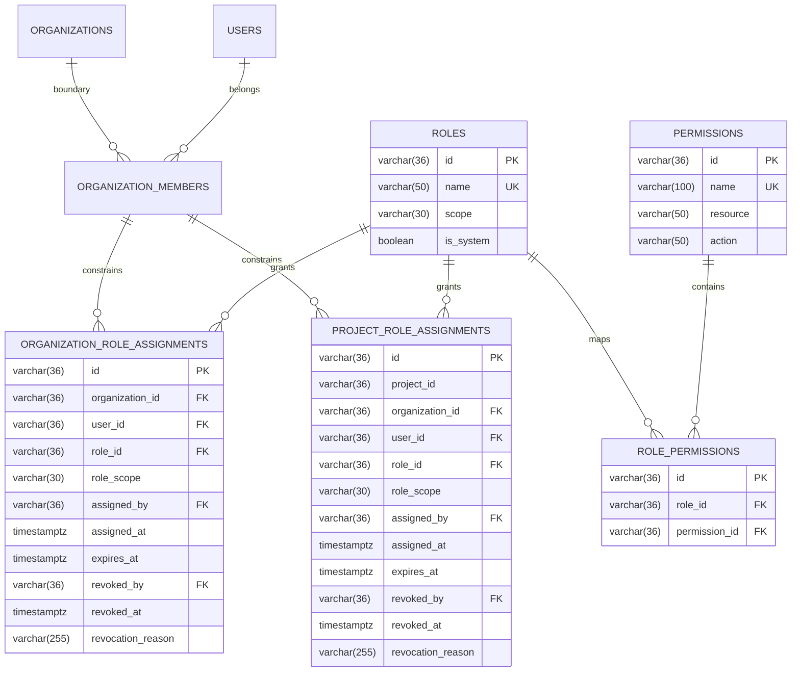

# Stage 4: Centralized Authorization Persistence & Scoped Role Assignments Architecture

> **Status:** Engineering Specification & Implementation Guide (Stage 4 Complete)  
> **Date:** 2026-11-02  
> **Author:** DevFlow Core Security & Platform Engineering  
> **Applies to:** `backend/app`, `backend/devflow-auth`, `docs/security/AUTHORIZATION_MODEL.md`, `docs/security/ADR-001-AUTHORIZATION-POLICY-RESOLUTION.md`  
> **Policy Source of Truth:** `docs/security/AUTHORIZATION_MODEL.md` (Status: ARB Approved) and `docs/security/ADR-001-AUTHORIZATION-POLICY-RESOLUTION.md` (*Status: Product-owner approved; ARB ratification pending*)  

---

## 1. Overview & Architectural Boundaries

Stage 4 transitions the DevFlow Centralized Authorization Architecture from in-memory canonical domain policies (Stage 3) to a production-grade, relational database-backed persistence model.

### 1.1 Strict Module Boundaries

DevFlow enforces an uncompromising architectural separation between authorization policy semantics and persistence infrastructure:

```
┌────────────────────────────────────────────────────────────────────────┐
│                        backend/devflow-auth                            │
│  (Pure Java Library — ZERO Framework, Spring, JPA, or SQL Dependencies)│
│                                                                        │
│  • Role (enum: 10 canonical roles across Platform, Org, Project)       │
│  • Permission (record: 48 canonical {resource}.{action} definitions)   │
│  • PermissionRegistry & RolePermissionMapping (policy source of truth) │
│  • SPI Ports: RoleResolver, MembershipValidator,                       │
│               ProjectAssignmentValidator, TenantBoundaryValidator      │
│  • Central AuthorizationEvaluator                                      │
└───────────────────────────────────▲────────────────────────────────────┘
                                    │ implements SPI ports
                                    │ (Zero reverse dependency)
┌───────────────────────────────────┴────────────────────────────────────┐
│                            backend/app                                 │
│          (Spring Boot, Spring Data JPA, PostgreSQL, Flyway)            │
│                                                                        │
│  • Entities: RoleEntity, PermissionEntity, RolePermissionEntity,       │
│              OrganizationRoleAssignment, ProjectRoleAssignment         │
│  • Repositories: RoleRepository, PermissionRepository,                 │
│                  RolePermissionRepository,                             │
│                  OrganizationRoleAssignmentRepository,                 │
│                  ProjectRoleAssignmentRepository                       │
│  • Persistence Adapters: DatabaseRoleResolver,                         │
│                          DatabaseMembershipValidator,                  │
│                          DatabaseProjectAssignmentValidator            │
│  • Catalog Consistency Validator & Seeder                              │
│  • Migration V13__create_authorization_tables.sql                      │
└────────────────────────────────────────────────────────────────────────┘
```

1. **Framework Independence of `devflow-auth`:** Core authorization domain types (`Role`, `Permission`, `RoleScope`), canonical registries (`PermissionRegistry`, `RolePermissionMapping`), and evaluation ports (`RoleResolver`, `MembershipValidator`, `ProjectAssignmentValidator`) remain pure Java with zero runtime dependencies.
2. **Persistence Encapsulation in `backend/app`:** Relational entities, Spring Data JPA repositories, database transaction boundaries, and Flyway migrations live exclusively within the backend application layer.
3. **No Divergence Rule:** The Stage 3 canonical registry and ADR-001 policy matrix remain the authoritative source of truth. Database catalog tables cannot alter or silently contradict canonical permissions or mappings. Custom user-defined roles remain strictly forbidden in Stage 4.

---

## 2. Database Schema & Relational Design

The persistence model is introduced in Flyway migration `V13__create_authorization_tables.sql`. All identifiers adhere to DevFlow's standard UUID convention stored as `VARCHAR(36)` with strict optimistic locking (`version BIGINT NOT NULL DEFAULT 0`).



### 2.1 Canonical Catalog Tables

1. **`roles`:**
   - Primary key: `id VARCHAR(36)`. Uses stable UUID v5 identifiers.
   - Unique constraints: `uk_roles_name (name)` and composite `uk_roles_id_scope (id, scope)`.
   - Check constraint: `chk_roles_scope CHECK (scope IN ('PLATFORM', 'ORGANIZATION', 'PROJECT'))`.
   - `is_system BOOLEAN NOT NULL DEFAULT TRUE` protects system roles against unauthorized alteration.
2. **`permissions`:**
   - Primary key: `id VARCHAR(36)`. Uses stable UUID v5 identifiers.
   - Unique constraints: `uk_permissions_name (name)` and `uk_permissions_resource_action (resource, action)`.
   - B-Tree index on `resource` for domain-level queries.
3. **`role_permissions`:**
   - Join entity linking `roles` and `permissions`.
   - Unique constraint: `uk_role_permissions_role_perm (role_id, permission_id)`.
   - Cascade delete on role/permission references.

### 2.2 Scoped Role Assignment Tables

1. **`organization_role_assignments`:**
   - Models tenant-scoped role grants (`ORGANIZATION_OWNER`, `ORGANIZATION_ADMIN`, `ORGANIZATION_MEMBER`, `ORGANIZATION_VIEWER`, `ORGANIZATION_BILLING`).
   - Composite foreign key `fk_org_role_assignments_org_user (organization_id, user_id) REFERENCES organization_members(organization_id, user_id) ON DELETE CASCADE`.
   - Scope check and foreign key: `role_scope = 'ORGANIZATION'` referencing `roles(id, scope)`.
   - Partial unique index: `uk_org_role_assignments_active (organization_id, user_id, role_id) WHERE revoked_at IS NULL`.
2. **`project_role_assignments`:**
   - Models project-scoped role grants (`PROJECT_LEAD`, `PROJECT_MEMBER`, `PROJECT_VIEWER`).
   - Explicitly records both `project_id` and `organization_id`.
   - Composite foreign key `fk_project_role_assignments_org_user (organization_id, user_id) REFERENCES organization_members(organization_id, user_id) ON DELETE CASCADE`.
   - Scope check and foreign key: `role_scope = 'PROJECT'` referencing `roles(id, scope)`.
   - Partial unique index: `uk_project_role_assignments_active (project_id, user_id, role_id) WHERE revoked_at IS NULL`.

---

## 3. Security Invariants Enforced at the Database Layer

The schema enforces core security guarantees directly via PostgreSQL relational constraints:

| # | Security Invariant | Database / Implementation Mechanism |
|---|-------------------|--------------------------------------|
| **1** | **No cross-tenant role assignment** | Composite FK `(organization_id, user_id) REFERENCES organization_members (organization_id, user_id)` guarantees that assignments can only be created for users who belong to that tenant organization. Cross-tenant combinations trigger foreign key violations. |
| **2** | **No project role without valid organization membership** | Foreign key to `organization_members(organization_id, user_id)` ensures membership exists. `DatabaseProjectAssignmentValidator` and `RoleAssignmentService` verify that membership status is strictly `ACTIVE` (not `SUSPENDED` or `INVITED`). |
| **3** | **No project role granting organization-wide permissions** | Project assignments enforce `role_scope = 'PROJECT'` and composite FK `(role_id, role_scope) REFERENCES roles(id, scope)`. Database rejects inserting an organization role into `project_role_assignments`. |
| **4** | **No organization role granting platform permissions** | Organization assignments enforce `role_scope = 'ORGANIZATION'` and composite FK `(role_id, role_scope) REFERENCES roles(id, scope)`. Database rejects inserting a platform role into `organization_role_assignments`. |
| **5** | **Organization billing isolation** | `ORGANIZATION_BILLING` contains strictly `billing.view` and `billing.manage` in `role_permissions` (2 mappings). It holds zero engineering permissions. |
| **6** | **Platform support read-only restriction** | `PLATFORM_SUPPORT` contains strictly `platform.support.case.read` and `platform.support.tenant.read` in `role_permissions` (2 mappings). |
| **7** | **Emergency access gating** | `PLATFORM_ADMIN` execution of `platform.emergency_access.execute` remains gated through Stage 3's out-of-band `EmergencyAccessValidator`. |
| **8** | **Revoked and expired assignments immediately neutralized** | Queries and resolvers filter assignments with `WHERE revoked_at IS NULL AND (expires_at IS NULL OR expires_at > :now)`. Entity domain methods `isActive()` and `isExpired()` enforce consistent state checks. |
| **9** | **No silent override of canonical policy** | Database reference data is validated on startup via `CatalogConsistencyValidator`. Any missing permission, incorrect mapping, or custom user-defined role halts initialization. |
| **10** | **Stage 3 multi-role composition** | Multiple active roles combine strictly via permission union in `AuthorizationEvaluator`. |

---

## 4. Role Assignment Lifecycle

Scoped role assignments support a complete, audited lifecycle:

```
             ┌─────────────────────────┐
             │       Not Assigned      │
             └────────────┬────────────┘
                          │ assignRole() [verifies ACTIVE membership,
                          │               verifies scope, checks duplicates]
                          ▼
             ┌─────────────────────────┐
             │         ACTIVE          │
             │ (revoked_at is NULL,    │
             │  expires_at > now/NULL) │
             └─────┬─────────────┬─────┘
                   │             │
      revokeRole() │             │ Time passes
      (with reason │             │ (now >= expires_at)
       and actor)  │             │
                   ▼             ▼
  ┌──────────────────────┐  ┌──────────────────────┐
  │       REVOKED        │  │       EXPIRED        │
  │ (revoked_at != NULL) │  │(expires_at <= now()) │
  └──────────┬───────────┘  └──────────┬───────────┘
             │                         │
             └────────────┬────────────┘
                          │ Reassignment
                          │ (permitted without unique constraint conflict)
                          ▼
             ┌─────────────────────────┐
             │     NEW ACTIVE RECORD   │
             └─────────────────────────┘
```

- **Active Deduplication:** Partial unique indexes on `(organization_id, user_id, role_id)` and `(project_id, user_id, role_id)` where `revoked_at IS NULL` prevent concurrent duplicate active grants.
- **Audit Preservation:** Revocation never physically deletes the row; it sets `revoked_by`, `revoked_at`, and `revocation_reason`, preserving the forensic security audit trail.
- **Immediate Invalidation:** Active evaluations instantly exclude assignments as soon as `revoked_at` is populated or `expires_at` is reached.

---

## 5. Legacy Membership Compatibility & Migration Backfill

### 5.1 Preservation of Existing `organization_members`

Existing code and contracts in `backend/app` continue to operate without disruption:
- `OrganizationMember` entity and `organization_members` table remain intact.
- Enums and values remain unchanged: `OrganizationRole` retains `OWNER`, `ADMIN`, `DEVELOPER`, `VIEWER`.
- `OrganizationMembershipStatus` retains `ACTIVE`, `INVITED`, `SUSPENDED`.
- `TeamRole` (`LEAD`, `MEMBER`) remains completely separate from organization and project roles.

### 5.2 Deterministic Backfill in V13

Migration `V13__create_authorization_tables.sql` executes an idempotent, deterministic backfill for all existing active members:

```sql
INSERT INTO organization_role_assignments (
    id, organization_id, user_id, role_id, role_scope,
    assigned_by, assigned_at, created_at, updated_at, version
)
SELECT
    gen_random_uuid()::varchar(36),
    om.organization_id,
    om.user_id,
    CASE om.role
        WHEN 'OWNER' THEN '30fbdce8-5d3e-5025-9fba-3af23689668b'
        WHEN 'ADMIN' THEN '8c830b56-e86c-5072-8471-2bd34e4e2522'
        WHEN 'DEVELOPER' THEN '18a58295-a572-51fe-a0a7-b9882954faec'
        WHEN 'VIEWER' THEN '272e64a4-aac5-57cb-bd88-3309d7ce7909'
    END,
    'ORGANIZATION',
    COALESCE(o.owner_id, om.user_id),
    COALESCE(om.joined_at, om.created_at, CURRENT_TIMESTAMP),
    COALESCE(om.created_at, CURRENT_TIMESTAMP),
    COALESCE(om.updated_at, CURRENT_TIMESTAMP),
    0
FROM organization_members om
JOIN organizations o ON om.organization_id = o.id
WHERE om.status = 'ACTIVE'
ON CONFLICT DO NOTHING;
```

### 5.3 Fallback Adapter Compatibility

`DatabaseRoleResolver` queries persistent `organization_role_assignments`. In the event an active member does not yet have an explicit assignment record (e.g., during transition phases), `DatabaseRoleResolver.mapLegacyOrganizationRole()` seamlessly maps the member's persisted role:
- `OrganizationRole.OWNER` $\rightarrow$ `Role.ORGANIZATION_OWNER`
- `OrganizationRole.ADMIN` $\rightarrow$ `Role.ORGANIZATION_ADMIN`
- `OrganizationRole.DEVELOPER` $\rightarrow$ `Role.ORGANIZATION_MEMBER`
- `OrganizationRole.VIEWER` $\rightarrow$ `Role.ORGANIZATION_VIEWER`

If an organization membership status is `SUSPENDED` or `INVITED`, `DatabaseRoleResolver` immediately returns an empty set, failing closed.

---

## 6. Stage 5 Integration Boundary

Stage 4 establishes the database persistence layer, entity model, repositories, and framework-independent adapters. The following operational integrations are intentionally deferred to **Stage 5**:

1. **Spring Security Filter Chain Integration:** Binding `AuthorizationEvaluator` and `DatabaseRoleResolver` to Spring Security's `SecurityFilterChain` and `@PreAuthorize` method security.
2. **JWT Claims Factory Updates:** Incorporating active scoped role hints into token generation (while maintaining stateless validation).
3. **Service Layer Migration:** Upgrading `OrganizationAuthorizationService` and `TeamAuthorizationService` to evaluate permissions directly through `AuthApi` rather than raw enum inspections.
4. **REST Controllers & API Endpoints:** Introducing management endpoints for assigning and revoking project and organization roles (`/api/v1/organizations/{id}/roles`, `/api/v1/projects/{id}/roles`).
