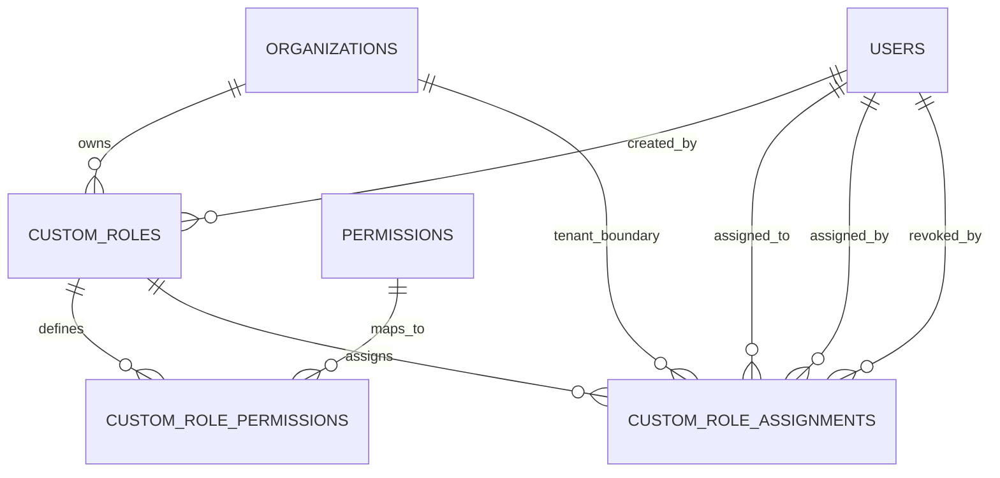
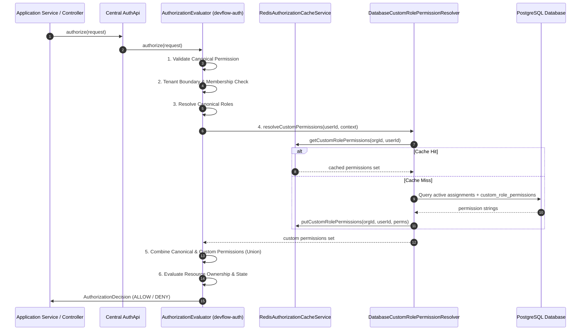

# Stage 7: Custom Roles & Permission Governance

> **Status:** Engineering Specification & Architecture Guide (Stage 7 Complete)  
> **Date:** 2026-11-09  
> **Author:** DevFlow Core Security & Platform Engineering  
> **Applies to:** `backend/app`, `backend/devflow-auth`, `docs/security/AUTHORIZATION_MODEL.md`, `docs/security/ADR-001-AUTHORIZATION-POLICY-RESOLUTION.md`  
> **Policy Source of Truth:** `docs/security/AUTHORIZATION_MODEL.md` (Status: ARB Approved) and `docs/security/ADR-001-AUTHORIZATION-POLICY-RESOLUTION.md` (*Status: Product-owner approved; ARB ratification pending*)  
> **Preceding Stages:** [Stage 4 Persistence](STAGE-4-PERSISTENCE-ARCHITECTURE.md), [Stage 5 Integration](STAGE-5-APPLICATION-INTEGRATION.md), [Stage 6 Role Management & Cache](STAGE-6-JWT-CACHE-ROLE-MANAGEMENT.md)  

---

## 1. Executive Summary & Stage 7 Objectives

Stage 7 introduces an enterprise-grade **Custom Role & Permission Governance System** to DevFlow's centralized multi-tenant authorization framework.

While canonical roles (`ORGANIZATION_OWNER`, `ORGANIZATION_ADMIN`, `ORGANIZATION_MEMBER`, `ORGANIZATION_VIEWER`, `ORGANIZATION_BILLING`, etc.) establish structural baseline governance, enterprise organizations require tailored role definitions reflecting real-world engineering responsibilities. Stage 7 enables organizations to create, manage, and assign custom roles such as:
- **QA Engineer:** `project.read`, `task.read`, `task.write`
- **Release Manager:** `project.read`, `cycle.manage`, `repo.read`
- **Security Reviewer:** `repo.read`, `repo.scan`, `comment.moderate`
- **Knowledge Specialist:** `kb.read`, `kb.write`, `kb.manage`
- **Read-Only Analyst:** `project.read`, `analytics.view`

### Core Design Principles
1. **Canonical Catalog as Sole Source of Truth:** Custom roles cannot invent arbitrary permission strings. All permissions must be registered in the canonical 48-permission catalog (`PermissionRegistry`).
2. **Strict Scope Confinement:** Custom roles are strictly organization-scoped. Platform-scoped permissions (`platform.*`) and system administration capabilities are strictly rejected.
3. **Privileged Permission Protection:** Irreversible organization deletion (`org.delete`) is exclusively reserved for canonical `ORGANIZATION_OWNER` and can never be attached to any custom role.
4. **Delegation Boundary Enforcement ($P \subseteq \text{Perms}(\text{caller})$):** An administrator cannot create or modify a custom role granting permissions they do not actively possess within the tenant.
5. **Single Evaluator Architecture:** Custom roles do not introduce a secondary authorization engine. They resolve via pure SPI ports (`CustomRolePermissionResolver`) directly into the central `AuthApi` pipeline, seamlessly combining with canonical role permissions via set union.
6. **Audit & Historical Integrity:** Safe deactivation preserves audit trails when historical assignments exist, and deletion is rejected when active assignments depend on the role.

---

## 2. Workstream A — Custom Role Data Model & Persistence

Custom roles and their assignments are persisted in PostgreSQL using Flyway migration `V14__create_custom_roles_tables.sql`.



### 2.1 Database Schema Definition (`V14`)

#### 1. Table `custom_roles`
Holds custom role metadata scoped to an organization tenant:

```sql
CREATE TABLE custom_roles (
    id VARCHAR(36) NOT NULL,
    organization_id VARCHAR(36) NOT NULL,
    name VARCHAR(50) NOT NULL,
    display_name VARCHAR(100) NOT NULL,
    description VARCHAR(500),
    is_active BOOLEAN NOT NULL DEFAULT TRUE,
    created_by VARCHAR(36) NOT NULL,
    created_at TIMESTAMP WITH TIME ZONE NOT NULL DEFAULT CURRENT_TIMESTAMP,
    updated_at TIMESTAMP WITH TIME ZONE NOT NULL DEFAULT CURRENT_TIMESTAMP,
    version BIGINT NOT NULL DEFAULT 0,
    CONSTRAINT pk_custom_roles PRIMARY KEY (id),
    CONSTRAINT fk_custom_roles_organization FOREIGN KEY (organization_id)
        REFERENCES organizations (id) ON DELETE CASCADE,
    CONSTRAINT fk_custom_roles_created_by FOREIGN KEY (created_by)
        REFERENCES users (id) ON DELETE RESTRICT,
    CONSTRAINT uk_custom_roles_org_name UNIQUE (organization_id, name)
);
```

#### 2. Table `custom_role_permissions`
Join table associating custom roles with authoritative canonical permissions from the `permissions` catalog table:

```sql
CREATE TABLE custom_role_permissions (
    id VARCHAR(36) NOT NULL,
    custom_role_id VARCHAR(36) NOT NULL,
    permission_id VARCHAR(36) NOT NULL,
    created_at TIMESTAMP WITH TIME ZONE NOT NULL DEFAULT CURRENT_TIMESTAMP,
    CONSTRAINT pk_custom_role_permissions PRIMARY KEY (id),
    CONSTRAINT fk_custom_role_perms_role FOREIGN KEY (custom_role_id)
        REFERENCES custom_roles (id) ON DELETE CASCADE,
    CONSTRAINT fk_custom_role_perms_perm FOREIGN KEY (permission_id)
        REFERENCES permissions (id) ON DELETE RESTRICT,
    CONSTRAINT uk_custom_role_permissions_role_perm UNIQUE (custom_role_id, permission_id)
);
```

#### 3. Table `custom_role_assignments`
Tracks assignments of custom roles to organization members:

```sql
CREATE TABLE custom_role_assignments (
    id VARCHAR(36) NOT NULL,
    organization_id VARCHAR(36) NOT NULL,
    user_id VARCHAR(36) NOT NULL,
    custom_role_id VARCHAR(36) NOT NULL,
    assigned_by VARCHAR(36) NOT NULL,
    assigned_at TIMESTAMP WITH TIME ZONE NOT NULL DEFAULT CURRENT_TIMESTAMP,
    expires_at TIMESTAMP WITH TIME ZONE,
    revoked_by VARCHAR(36),
    revoked_at TIMESTAMP WITH TIME ZONE,
    revocation_reason VARCHAR(255),
    created_at TIMESTAMP WITH TIME ZONE NOT NULL DEFAULT CURRENT_TIMESTAMP,
    updated_at TIMESTAMP WITH TIME ZONE NOT NULL DEFAULT CURRENT_TIMESTAMP,
    version BIGINT NOT NULL DEFAULT 0,
    CONSTRAINT pk_custom_role_assignments PRIMARY KEY (id),
    CONSTRAINT fk_cra_organization FOREIGN KEY (organization_id)
        REFERENCES organizations (id) ON DELETE CASCADE,
    CONSTRAINT fk_cra_user FOREIGN KEY (user_id)
        REFERENCES users (id) ON DELETE CASCADE,
    CONSTRAINT fk_cra_custom_role FOREIGN KEY (custom_role_id)
        REFERENCES custom_roles (id) ON DELETE RESTRICT,
    CONSTRAINT fk_cra_assigned_by FOREIGN KEY (assigned_by)
        REFERENCES users (id) ON DELETE RESTRICT,
    CONSTRAINT fk_cra_revoked_by FOREIGN KEY (revoked_by)
        REFERENCES users (id) ON DELETE RESTRICT
);

-- Partial index enforcing at most one active assignment per (org, user, custom_role)
CREATE UNIQUE INDEX idx_custom_role_assignments_active_unique
    ON custom_role_assignments (organization_id, user_id, custom_role_id)
    WHERE revoked_at IS NULL;
```

### 2.2 Entity Invariants & Lifecycle
- **Tenant Scope:** Every custom role entity (`CustomRoleEntity`) is linked to a non-null `Organization`.
- **Name Normalization:** Custom role names are normalized to upper-case (`Locale.ROOT`) to ensure consistent, case-insensitive uniqueness within an organization tenant. Identical role names can freely exist in separate organization tenants.
- **Optimistic Locking:** Both `CustomRoleEntity` and `CustomRoleAssignment` feature JPA `@Version` optimistic locking to reject concurrent modifications.
- **Collection Management:** In `CustomRoleEntity`, `rolePermissions` uses `cascade = CascadeType.ALL, orphanRemoval = true`. Updates compute delta sets without replacing the underlying managed `PersistentSet`, preventing Hibernate unique constraint conflicts.
- **Safe Deactivation vs Hard Deletion:**
  - If a role has **active assignments**, deletion is rejected with `409 Conflict` (`CustomRoleDeletionException`).
  - If a role has **historical (revoked/expired) assignments**, deletion safely archives the role by setting `active = false` (preserving historical audit trails).
  - If a role has **never been assigned**, it is hard deleted along with its permission mappings.

---

## 3. Workstream B — Permission Governance & Delegation Policy

### 3.1 Governance Boundaries
The permission governance engine (`PermissionGovernanceService`) validates incoming permission sets against canonical rules before persistence:

| Governance Check | Policy Rule | HTTP Response on Violation |
| :--- | :--- | :--- |
| **Catalog Registration** | Permission must exist in `PermissionRegistry.canonical()` (48 registered permissions). Arbitrary or ad-hoc permission strings are rejected. | `400 Bad Request` |
| **Scope Confinement** | Platform permissions (`platform.*`, e.g. `platform.tenant.provision`, `platform.audit.read`, `platform.emergency_access.execute`) cannot be included in organization custom roles. | `400 Bad Request` |
| **Privileged Protection** | `org.delete` is exclusively reserved for the canonical `ORGANIZATION_OWNER`. It can never be included in any custom role. | `400 Bad Request` |
| **Composite Prerequisites** | Composite permission rules are strictly enforced (e.g. `analytics.export` requires `analytics.view` to be included). | `400 Bad Request` |
| **Delegation Boundary** | Caller must hold all delegated permissions ($P_{\text{custom}} \subseteq P_{\text{caller}}$). Non-owners cannot delegate permissions they do not possess (e.g. `billing.manage`). | `403 Forbidden` |

### 3.2 Canonical Permission Classification (48 Permissions)

```
All 48 Canonical Permissions
├── 8 Platform Permissions (STRICTLY PROHIBITED in custom roles)
│   ├── platform.tenant.provision
│   ├── platform.tenant.deprovision
│   ├── platform.featureflag.manage
│   ├── platform.observability.read
│   ├── platform.audit.read
│   ├── platform.support.case.read
│   ├── platform.support.tenant.read
│   └── platform.emergency_access.execute
│
├── 2 Privileged Owner Permissions
│   ├── org.delete (STRICTLY PROHIBITED in custom roles)
│   └── org.manage (Owner-only delegation)
│
├── 2 Billing Permissions (Owner-only delegation)
│   ├── billing.view
│   └── billing.manage
│
└── 36 Delegable Engineering & Collaboration Permissions
    ├── Project & Task: project.read, project.write, project.delete, task.read, task.create, task.write, task.assign, task.delete, cycle.manage
    ├── Repositories: repo.read, repo.connect, repo.disconnect, repo.scan, repo.configure
    ├── AI Engine: ai.chat, ai.review, ai.review.approve, ai.configure
    ├── Knowledge Base: kb.read, kb.write, kb.manage, kb.delete
    ├── Analytics: analytics.view, analytics.export, analytics.configure
    ├── Automations: automation.read, automation.configure, automation.delete
    ├── Comments: comment.create, comment.edit, comment.delete, comment.moderate
    ├── Notifications: notification.configure, notification.broadcast
    └── Membership: member.invite, member.remove
```

### 3.3 Delegation Boundary Formal Rule
For any custom role creation or update in organization tenant $O$ by caller $U$:

$$\text{Perms}(R_{\text{custom}}) \subseteq \text{Perms}_{\text{effective}}(U, O)$$

Where:
- $\text{Perms}_{\text{effective}}(U, O) = \text{Perms}_{\text{canonical}}(U, O) \cup \text{Perms}_{\text{custom\_assigned}}(U, O)$.
- If $U$ holds canonical `ORGANIZATION_OWNER`, they possess all non-platform organization permissions and may delegate any non-platform organization permission (except `org.delete`).
- If $U$ holds canonical `ORGANIZATION_ADMIN`, they can only delegate permissions actively held by `ORGANIZATION_ADMIN` or permissions granted to them via active custom roles.
- Principals without `ORGANIZATION_OWNER` or `ORGANIZATION_ADMIN` are rejected immediately with `403 Forbidden`.

---

## 4. Workstream C — Custom Role Management REST APIs

Base path: `/api/v1/organizations/{organizationId}/custom-roles`

### 4.1 Endpoint Specifications

#### 1. List Custom Roles
- **Method & Path:** `GET /api/v1/organizations/{organizationId}/custom-roles`
- **Query Parameters:** `activeOnly` (boolean, optional)
- **Authorization:** `ORGANIZATION_OWNER` or `ORGANIZATION_ADMIN`
- **Response `200 OK`:**
  ```json
  [
    {
      "id": "c7a80b62-4db1-4e42-990a-a03530be9082",
      "organizationId": "1b084920-f4d0-4bf6-90e6-993dcf68e8e7",
      "name": "QA_ENGINEER",
      "displayName": "QA Engineer",
      "description": "Responsible for quality assurance and testing",
      "active": true,
      "permissions": ["project.read", "task.read", "task.write"],
      "createdBy": "4c43a41b-8517-4927-b6f7-bce457635684",
      "createdAt": "2026-11-09T18:00:00Z",
      "updatedAt": "2026-11-09T18:00:00Z",
      "version": 0
    }
  ]
  ```

#### 2. Create Custom Role
- **Method & Path:** `POST /api/v1/organizations/{organizationId}/custom-roles`
- **Authorization:** `ORGANIZATION_OWNER` or `ORGANIZATION_ADMIN` (with delegation authority)
- **Request Body:**
  ```json
  {
    "name": "RELEASE_MANAGER",
    "displayName": "Release Manager",
    "description": "Coordinates deployments and cycle management",
    "permissions": ["project.read", "cycle.manage"]
  }
  ```
- **Responses:**
  - `201 Created`: Returns created `CustomRoleResponse`.
  - `400 Bad Request`: Unknown permission, platform permission, `org.delete`, or composite violation.
  - `401 Unauthorized`: Missing or invalid token.
  - `403 Forbidden`: Caller lacks authority to delegate one or more requested permissions.
  - `409 Conflict`: Role name already exists within this organization.

#### 3. Retrieve Custom Role Details
- **Method & Path:** `GET /api/v1/organizations/{organizationId}/custom-roles/{roleId}`
- **Authorization:** `ORGANIZATION_OWNER` or `ORGANIZATION_ADMIN`
- **Responses:**
  - `200 OK`: Returns `CustomRoleResponse`.
  - `404 Not Found`: Role ID does not exist in this organization.

#### 4. Update Custom Role Definition
- **Method & Path:** `PUT /api/v1/organizations/{organizationId}/custom-roles/{roleId}`
- **Authorization:** `ORGANIZATION_OWNER` or `ORGANIZATION_ADMIN` (with delegation authority)
- **Request Body:**
  ```json
  {
    "displayName": "Senior Release Manager",
    "description": "Updated duties",
    "active": true,
    "permissions": ["project.read", "cycle.manage", "repo.read"]
  }
  ```
- **Responses:**
  - `200 OK`: Returns updated `CustomRoleResponse`.
  - `400 Bad Request`: Validation failure or composite rule violation.
  - `403 Forbidden`: Attempting to delegate unpossessed permissions.
  - `404 Not Found`: Role not found in organization.

#### 5. Delete or Deactivate Custom Role
- **Method & Path:** `DELETE /api/v1/organizations/{organizationId}/custom-roles/{roleId}`
- **Authorization:** `ORGANIZATION_OWNER` or `ORGANIZATION_ADMIN`
- **Behavior:**
  - If active assignments exist: returns `409 Conflict`.
  - If historical assignments exist: sets `active = false` (safe archival) and returns `204 No Content`.
  - If unused: hard deletes the role and returns `204 No Content`.

---

## 5. Workstream D — Role Assignment Integration

Custom roles integrate directly into the existing role assignment system (`RoleAssignmentService`) and REST endpoints under `/api/v1/organizations/{organizationId}/roles`:

```
POST   /api/v1/organizations/{organizationId}/roles
DELETE /api/v1/organizations/{organizationId}/roles/{assignmentId}
GET    /api/v1/organizations/{organizationId}/roles
```

### 5.1 Granting Custom Roles
When granting a role via `POST /api/v1/organizations/{organizationId}/roles`:
1. The request payload accepts either a canonical role name (e.g. `ORGANIZATION_ADMIN`) or a custom role identifier (role name such as `QA_ENGINEER` or role UUID).
2. The service checks `CustomRoleRepository` within `organizationId`.
3. If matched, the assignment verifies:
   - Target user holds **active membership** in the organization tenant.
   - The custom role is **active** (`active = true`). Disabled roles cannot be assigned.
   - No duplicate active assignment exists for `(organizationId, targetUserId, customRoleId)`.
4. The assignment is saved in `custom_role_assignments` and returned via the unified `RoleAssignmentResponse`.

### 5.2 Revoking Custom Roles
When revoking an assignment via `DELETE /api/v1/organizations/{organizationId}/roles/{assignmentId}`:
1. `RoleAssignmentService` checks canonical assignments first. If not found, it checks `CustomRoleAssignmentRepository`.
2. Validates tenant ownership of the assignment.
3. Sets `revokedAt`, `revokedBy`, and `revocationReason`.
4. Triggers immediate cache invalidation for the affected user.

---

## 6. Workstream E — Central Authorization Engine & Caching

### 6.1 Unified Evaluation Flow
Custom roles do not create a separate evaluation pipeline. They implement the pure Java SPI `CustomRolePermissionResolver` registered with `AuthorizationEvaluator`:



### 6.2 Redis Cache Invalidation Strategy
Permissions and role assignments are cached in Redis with strict tenant isolation:

| Cache Key Pattern | Cached Content | TTL | Invalidation Event |
| :--- | :--- | :--- | :--- |
| `devflow:auth:org:{orgId}:user:{userId}:roles` | Canonical Organization Roles | 300s | Canonical role grant / revoke / membership change |
| `devflow:auth:org:{orgId}:user:{userId}:custom-perms` | Active Custom Role Permissions | 300s | Custom role assignment grant / revoke / expiration |
| `devflow:auth:org:{orgId}:custom-role:{roleId}:perms` | Permissions attached to Custom Role | 300s | Custom role update, deactivation, or deletion |

#### Invalidation Invariants:
1. **Role Definition Update:** When a custom role's permissions are modified or the role is deactivated, `cacheService.evictCustomRole(organizationId, roleId)` is invoked, clearing all cached entries for that role and affected tenant users.
2. **Assignment Lifecycle Change:** When a custom role is granted or revoked, `cacheService.evictUser(organizationId, userId)` is invoked immediately.
3. **No Stale Privilege Window:** Cache eviction is synchronous with transactional persistence, guaranteeing that revoked privileges take effect on the very next request.

---

## 7. Relationship Between Custom Roles and Canonical Roles

| Dimension | Canonical Roles | Custom Roles |
| :--- | :--- | :--- |
| **Source of Definition** | Hardcoded in `Role` enum & ADR-001 | User-defined in `custom_roles` table |
| **Scope** | Platform, Organization, and Project scopes | Organization scope only |
| **Structural Governance** | Defines ownership, tenancy, billing isolation | Defines fine-grained functional responsibilities |
| **Persistence** | Referenced by name in `organization_role_assignments` | Identified by UUID in `custom_role_assignments` |
| **Hierarchy & Inheritance** | Strict compile-time transitive DAG | Flat permission sets (no role nesting) |
| **Extensibility** | Fixed 10 canonical roles | Dynamically created per organization tenant |
| **Authority** | Baseline identity within organization | Additive capability grants |

---

## 8. Security Considerations & Failure Modes

1. **Fail-Closed Design:** Any failure in `DatabaseCustomRolePermissionResolver` (database disconnection, timeout, deserialization error) falls back to `Collections.emptySet()`, ensuring access is denied rather than erroneously granted.
2. **Tenant Isolation Invariant:** Custom roles can only be queried, updated, deleted, or assigned within their enclosing organization. Cross-tenant IDs fail closed with `403 Forbidden` or `404 Not Found`.
3. **Active Membership Precondition:** If an organization member's membership status is set to `SUSPENDED` or revoked, the centralized evaluator rejects authorization requests immediately before checking custom role assignments.
4. **Optimistic Locking:** Concurrent updates to custom role permissions are prevented via `@Version` locking on `custom_roles`, eliminating race conditions during permission updates.
5. **No Token Persistence:** Custom role permissions are NEVER stored in JWTs, ensuring changes take effect immediately without requiring user re-authentication or waiting for token expiry.

---

## 9. Known Limitations

1. **Organization-Scoped Only:** Custom roles are currently constrained to the organization tenant scope. Custom project-specific roles (e.g. project-scoped custom roles) are planned for a subsequent stage.
2. **Canonical Permission Catalog Confinement:** Custom roles cannot define custom actions beyond the 48 canonical permissions. Adding new permission primitives requires a code addition to `PermissionRegistry` and database migration.
3. **No Direct Role-in-Role Hierarchy:** Custom roles cannot inherit from other custom roles. They are modelled as flat sets of canonical permissions.
