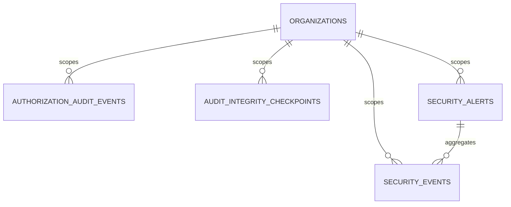

# Stage 8: Authorization Audit & Security Monitoring

> **Status:** Engineering Specification & Architecture Guide (Stage 8 Complete)  
> **Date:** 2026-11-10  
> **Author:** DevFlow Core Security & Platform Engineering  
> **Applies to:** `backend/app`, `backend/devflow-auth`, `docs/security/AUTHORIZATION_MODEL.md`, `docs/security/ADR-001-AUTHORIZATION-POLICY-RESOLUTION.md`  
> **Policy Source of Truth:** `docs/security/AUTHORIZATION_MODEL.md` (Status: ARB Approved) and `docs/security/ADR-001-AUTHORIZATION-POLICY-RESOLUTION.md` (*Status: Product-owner approved; ARB ratification pending*)  
> **Preceding Stages:** [Stage 4 Persistence](STAGE-4-PERSISTENCE-ARCHITECTURE.md), [Stage 5 Integration](STAGE-5-APPLICATION-INTEGRATION.md), [Stage 6 Role Management & Cache](STAGE-6-JWT-CACHE-ROLE-MANAGEMENT.md), [Stage 7 Custom Roles & Governance](STAGE-7-CUSTOM-ROLES-GOVERNANCE.md)  

---

## 1. Executive Summary & Stage 8 Objectives

Stage 8 delivers an enterprise-grade **Centralized Authorization Audit & Security Monitoring Subsystem** for DevFlow. Building upon the foundational authorization architecture, scoped role persistence, caching layer, and custom role governance from Stages 1–7, Stage 8 provides end-to-end visibility, verifiable cryptographic integrity, and proactive threat detection across all multi-tenant operations.

### Key Capabilities Delivered
1. **Centralized Audit Logging:** Durable recording of all authorization decisions (`ALLOW` and `DENY`) with structured denial reasons, actor context, tenant boundaries, resource metadata, and distributed correlation tracking via `TraceContext`.
2. **Comprehensive Change History:** Audit trails for all security-sensitive operations across canonical role assignments, custom role governance, and organization memberships.
3. **Tamper-Evident Cryptographic Integrity:** Monotonic sequence ordering, SHA-256 block hash-chaining, HMAC-SHA256 integrity checkpoints, and PostgreSQL database triggers enforcing append-only immutability.
4. **Deterministic Security Event Detection:** Pluggable, explainable detection engine tracking repeated authorization denials, cross-tenant violations, project scope escapes, unauthorized privileged role grants, delegation violations, and rapid bulk role modifications.
5. **Tenant-Scoped Security & Alert APIs:** REST endpoints under `/api/v1/organizations/{organizationId}/security` for searching audit logs, verifying cryptographic integrity, reviewing detected events, and managing alert lifecycles (acknowledgement and resolution).
6. **Strict Fail-Safe vs. Fail-Closed Invariants:** Authorization evaluation (`AuthApi.authorize`) fails safe (persistence failures never grant unapproved access), while administrative mutations (`RoleAssignmentService`, `CustomRoleService`, etc.) fail closed (transactional rollback guarantees mutations never occur without durable audit logs).

---

## 2. Workstream A — Centralized Authorization Audit Logging

### 2.1 Audit Event Architecture & Model

The audit event model is defined in the framework-independent `devflow-auth` module and persisted by the `app` module:

- **Interface:** `com.devflow.modules.auth.audit.AuthorizationAuditRecorder`
- **Domain Event:** `com.devflow.modules.auth.audit.AuthorizationAuditEvent`
- **Event Types:** `com.devflow.modules.auth.audit.AuthorizationAuditEventType`

```
+---------------------------------------------------------------------------------+
|                         AuthorizationAuditEvent                                 |
+---------------------------------------------------------------------------------+
| - id: String (UUID)                                                            |
| - timestamp: Instant (UTC)                                                      |
| - eventType: AuthorizationAuditEventType                                        |
| - principalId: String                                                           |
| - organizationId: String (nullable)                                             |
| - projectId: String (nullable)                                                  |
| - requestedPermission: Permission (canonical or custom)                         |
| - resourceType: String                                                          |
| - resourceId: String                                                            |
| - decision: AuthorizationDecision (ALLOW / DENY)                                |
| - denialReason: String (nullable)                                               |
| - correlationId: String (propagated via TraceContext)                           |
| - targetEntityType: String (nullable)                                           |
| - targetEntityId: String (nullable)                                             |
| - previousState: String (JSON / string descriptor)                              |
| - newState: String (JSON / string descriptor)                                   |
| - rationale: String (administrative justification)                              |
+---------------------------------------------------------------------------------+
```

### 2.2 Correlation & Context Propagation

Every authorization request resolves a unique `correlationId` using `TraceContext`:
1. If the request originates from HTTP, the `X-Correlation-ID` or `X-Request-ID` header is captured.
2. If absent, a cryptographically random UUID is generated and set into the thread-local context.
3. The central `AuthorizationEvaluator` automatically extracts this correlation ID and populates it on every recorded audit event.

### 2.3 Sanitization & Data Protection Invariants
- **No Credentials or Secrets:** Audit records never store JWT tokens, hashed passwords, session cookies, or raw authorization headers.
- **Stable Identifiers:** Target users, roles, organizations, and projects are captured using UUID identifiers rather than serialized entity objects.
- **Fail-Safe Access:** In the core evaluator, audit recording failures are caught and logged at `ERROR` level without overriding the computed `AuthorizationDecision`.

---

## 3. Workstream B — Role & Permission Change History

Every security-sensitive administrative operation triggers a durable audit event:

### 3.1 Audited Operations Matrix

| Category | Event Type | Triggering Service | Captured Metadata |
| :--- | :--- | :--- | :--- |
| **Canonical Roles** | `ROLE_GRANTED` | `RoleAssignmentService` | Actor, target user, role, scope, expiry |
| | `ROLE_REVOKED` | `RoleAssignmentService` | Actor, target user, role, revocation reason |
| | `ROLE_ASSIGNMENT_SUPERSEDED` | `RoleAssignmentService` | Previous assignment ID, new role |
| | `ROLE_ASSIGNMENT_EXPIRED` | `RoleAssignmentService` | Target user, expired role, expiration time |
| | `PRIVILEGED_ROLE_GRANT_ATTEMPTED` | `RoleAssignmentService` | Actor, target role, violation reason |
| **Custom Roles** | `CUSTOM_ROLE_CREATED` | `CustomRoleService` | Role ID, role name, initial permissions |
| | `CUSTOM_ROLE_UPDATED` | `CustomRoleService` | Previous display name/desc, new state |
| | `CUSTOM_ROLE_DISABLED` | `CustomRoleService` | Role ID, reason, actor |
| | `CUSTOM_ROLE_DELETED` | `CustomRoleService` | Role ID, deletion metadata |
| | `CUSTOM_ROLE_PERMISSION_ADDED` | `CustomRoleService` | Added canonical permission, updated set |
| | `CUSTOM_ROLE_PERMISSION_REMOVED` | `CustomRoleService` | Removed permission, updated set |
| **Governance** | `PERMISSION_DELEGATION_VIOLATION_ATTEMPTED`| `PermissionGovernanceService` | Actor, unpossessed permissions attempted |
| | `MEMBERSHIP_ROLE_CHANGED` | `OrganizationMembershipService`| Target user, old role, new role |
| | `MEMBERSHIP_REMOVED` | `OrganizationMembershipService`| Target user, removal reason |
| **Alert Lifecycle** | `SECURITY_ALERT_ACKNOWLEDGED` | `SecurityAlertService` | Alert ID, acknowledging admin ID |
| | `SECURITY_ALERT_RESOLVED` | `SecurityAlertService` | Alert ID, resolving admin ID, reason |
| **Integrity** | `AUDIT_INTEGRITY_VERIFIED` | `OrganizationSecurityMonitoringController`| Verified range, verification status |

---

## 4. Workstream C — Tamper-Evident Cryptographic Integrity

### 4.1 Threat Model & Defenses

| Threat Vector | Attack Description | DevFlow Defense Mechanism |
| :--- | :--- | :--- |
| **Log Injection** | Attacker inserts fraudulent historical records | Monotonic sequence constraint & hash-chain mismatch |
| **Log Deletion** | Attacker deletes incriminating denial records | Gap detection in sequence numbers + PostgreSQL trigger |
| **Log Modification** | Attacker modifies payload to disguise breach | SHA-256 payload hash verification mismatch |
| **Chain Rewriting** | Attacker recalculates entire hash chain in DB | Out-of-band HMAC-SHA256 integrity checkpoints |
| **Direct DB Tampering**| Attacker with DB access attempts UPDATE/DELETE | PostgreSQL row-level triggers block UPDATE/DELETE |

### 4.2 Hash Chain Specification

Each persisted audit record contains:
- `sequence_number`: Monotonically increasing `BIGINT` per organization.
- `payload_hash`: SHA-256 hash of canonical event fields.
- `previous_record_hash`: Pointer to the `record_hash` of sequence $N-1$ (Genesis uses `"GENESIS"`).
- `record_hash`: SHA-256 hash of `sequence_number || payload_hash || previous_record_hash`.

```
+---------------------------------------------------------------------------------+
|                                 Hash Chain                                      |
+---------------------------------------------------------------------------------+
| Event N-1:                                                                      |
|   Seq: 101, PrevHash: H(100), PayloadHash: P_101                               |
|   RecordHash = SHA256(101 || P_101 || H(100)) = H(101)                         |
|                                     |                                           |
|                                     v                                           |
| Event N:                                                                        |
|   Seq: 102, PrevHash: H(101), PayloadHash: P_102                               |
|   RecordHash = SHA256(102 || P_102 || H(101)) = H(102)                         |
|                                     |                                           |
|                                     v                                           |
| Event N+1:                                                                      |
|   Seq: 103, PrevHash: H(102), PayloadHash: P_103                               |
|   RecordHash = SHA256(103 || P_103 || H(102)) = H(103)                         |
+---------------------------------------------------------------------------------+
```

### 4.3 HMAC-SHA256 Integrity Checkpoints

Periodic or on-demand checkpoints summarize audit sequence ranges:
- `AuditIntegrityCheckpointEntity` stores `start_sequence`, `end_sequence`, `cumulative_hash`, and `hmac_signature`.
- The HMAC key (`devflow.security.monitoring.integrity.hmac-secret`) is injected from secure environment variables / key management systems, separate from database storage.
- Verification checks:
  1. Sequence continuity (no missing or skipped sequence numbers).
  2. Payload hash recomputation matches stored `payload_hash`.
  3. Hash chain continuity (`previous_record_hash == record_hash[n-1]`).
  4. Checkpoint HMAC signature validity.

### 4.4 PostgreSQL Database Hardening Triggers (`V15`)

```sql
CREATE OR REPLACE FUNCTION fn_prevent_audit_log_update_delete()
RETURNS TRIGGER AS $$
BEGIN
    RAISE EXCEPTION 'Audit logs are immutable append-only records. UPDATE and DELETE operations are strictly prohibited.'
        USING ERRCODE = '55000';
END;
$$ LANGUAGE plpgsql;

CREATE TRIGGER trg_prevent_audit_log_update_delete
BEFORE UPDATE OR DELETE ON authorization_audit_events
FOR EACH ROW EXECUTE FUNCTION fn_prevent_audit_log_update_delete();
```

---

## 5. Workstream D — Suspicious Activity Detection Engine

### 5.1 Architecture

The detection engine operates deterministically upon the ingestion of audit events:
1. `LoggingAuthorizationAuditRecorder` persists the audit record.
2. It publishes an `AuthorizationAuditEventPublishedEvent` across Spring application events.
3. `SecurityMonitoringService` routes the event through all registered `SecurityDetectionRule` implementations.
4. If a rule triggers, a `SecurityEventEntity` is created and correlated to an active `SecurityAlertEntity`.

```
[Audit Event Ingested]
         |
         v
[Audit Repository Persisted (Append-Only)]
         |
         v
[Spring Event Publisher]
         |
         v
[SecurityMonitoringService]
         |
  +------+------+------+------+------+------+
  |      |      |      |      |      |      |
 [R1]   [R2]   [R3]   [R4]   [R5]   [R6]   ... (Detection Rules)
  |      |      |      |      |      |      |
  +------+------+------+------+------+------+
         |
   (Violation Detected)
         |
         v
[SecurityEventEntity Created (Linked to Evidence)]
         |
         v
[SecurityAlertService Deduplication & Alert Lifecycle]
```

### 5.2 Deterministic Detection Rules Catalog

| Rule ID | Rule Class | Threshold Default | Window | Severity | Trigger Condition |
| :--- | :--- | :--- | :--- | :--- | :--- |
| `REPEATED_AUTHORIZATION_DENIALS` | `RepeatedAuthorizationDenialsRule` | 5 denials | 10 mins | `MEDIUM` / `HIGH` | Same principal denied repeatedly within tenant |
| `CROSS_TENANT_ACCESS_VIOLATION` | `CrossTenantAccessViolationRule` | 3 attempts | 15 mins | `HIGH` | Principal attempting cross-tenant access |
| `PROJECT_SCOPE_VIOLATION` | `ProjectScopeViolationRule` | 5 violations | 10 mins | `MEDIUM` | User accessing unassigned projects |
| `UNAUTHORIZED_PRIVILEGED_ROLE_GRANT`| `UnauthorizedPrivilegedRoleGrantRule`| 1 attempt | 15 mins | `CRITICAL` | Attempt to grant OWNER/BILLING without authority |
| `UNAUTHORIZED_PERMISSION_DELEGATION`| `UnauthorizedPermissionDelegationRule`| 1 attempt | 15 mins | `HIGH` | Attempt to delegate unpossessed permissions |
| `RAPID_BULK_ROLE_MODIFICATIONS` | `RapidBulkRoleModificationsRule` | 10 changes | 5 mins | `HIGH` | High-frequency role mutations by single actor |

### 5.3 Alert Deduplication & Lifecycle

To prevent alert flooding:
- Alerts are grouped by `(organization_id, rule_id, actor_id, status = OPEN | ACKNOWLEDGED)`.
- If an active alert exists, the existing alert's `occurrence_count` is incremented, `last_seen_at` is updated, and the new `SecurityEventEntity` is linked to it.
- Only when an alert is transitioned to `RESOLVED` will future violations generate a fresh alert.

---

## 6. Workstream E — Tenant-Scoped Security REST APIs

All endpoints are rooted under:  
`/api/v1/organizations/{organizationId}/security`

### 6.1 Endpoints Specification

| Method | Endpoint | Description | Required Role |
| :--- | :--- | :--- | :--- |
| `GET` | `/audit-logs` | Filter and paginate audit logs | `ORGANIZATION_OWNER`, `ORGANIZATION_ADMIN` |
| `GET` | `/audit-logs/{eventId}` | Retrieve single audit log details | `ORGANIZATION_OWNER`, `ORGANIZATION_ADMIN` |
| `GET` | `/audit-logs/integrity` | Cryptographically verify audit chain | `ORGANIZATION_OWNER`, `ORGANIZATION_ADMIN` |
| `GET` | `/events` | List detected security events | `ORGANIZATION_OWNER`, `ORGANIZATION_ADMIN` |
| `GET` | `/events/{eventId}` | Retrieve security event details | `ORGANIZATION_OWNER`, `ORGANIZATION_ADMIN` |
| `GET` | `/alerts` | List security alerts with filters | `ORGANIZATION_OWNER`, `ORGANIZATION_ADMIN` |
| `GET` | `/alerts/{alertId}` | Retrieve security alert details | `ORGANIZATION_OWNER`, `ORGANIZATION_ADMIN` |
| `POST` | `/alerts/{alertId}/acknowledge` | Acknowledge an open alert | `ORGANIZATION_OWNER`, `ORGANIZATION_ADMIN` |
| `POST` | `/alerts/{alertId}/resolve` | Resolve an alert with justification | `ORGANIZATION_OWNER`, `ORGANIZATION_ADMIN` |

### 6.2 Security Invariants of APIs
1. **Strict Tenant Boundary:** Users cannot view or verify events outside their authorized organization.
2. **Access Control:** Gated exclusively to `ORGANIZATION_OWNER` or `ORGANIZATION_ADMIN` using central `DatabaseRoleResolver`.
3. **No Mutations to Audit Records:** No REST endpoint exists to update or delete audit records or checkpoints.
4. **Audited Investigation:** Acknowledging or resolving an alert emits a persistent audit event (`SECURITY_ALERT_ACKNOWLEDGED`, `SECURITY_ALERT_RESOLVED`).

---

## 7. Workstream F — Data Model & Persistence (`V15`)

### 7.1 Entity Relationship Diagram



### 7.2 Tables & Primary Indexes

1. **`authorization_audit_events`**
   - Indexes: `(organization_id, sequence_number)`, `(principal_id, timestamp)`, `(organization_id, event_type)`, `(correlation_id)`
2. **`audit_integrity_checkpoints`**
   - Indexes: `(organization_id, end_sequence)`
3. **`security_events`**
   - Indexes: `(organization_id, timestamp)`, `(alert_id)`, `(rule_id, organization_id)`
4. **`security_alerts`**
   - Indexes: `(organization_id, status)`, `(organization_id, rule_id, status)`

---

## 8. Workstream G — Reliability & Failure Modes

### 8.1 Fail-Safe vs. Fail-Closed Invariants

| Component | Operation | Invariant | Failure Mode Handling |
| :--- | :--- | :--- | :--- |
| **`AuthorizationEvaluator`** | `AuthApi.authorize` | **Fail-Safe** | If audit logging fails, the authorization decision is returned safely to prevent denial-of-service. Logged at `ERROR`. |
| **`RoleAssignmentService`** | Role Grant / Revoke | **Fail-Closed** | Transactional: audit recording failure aborts the transaction, preventing unrecorded privilege changes. |
| **`CustomRoleService`** | Custom Role Lifecycle | **Fail-Closed** | Transactional: creation/mutation aborts if audit recording fails. |
| **`OrganizationMembershipService`**| Member Removal / Update | **Fail-Closed** | Transactional: membership change aborts if audit recording fails. |

---

## 9. Verification & Test Suite Summary

The Stage 8 implementation is validated by a test suite spanning unit, contract, database integration, security trigger, and REST API tests:

1. `AuditIntegrityServiceTest` (9 tests): Validates sequence monotonicity, SHA-256 chaining, gap detection, payload tampering detection, reordering detection, checkpoint HMAC verification, and concurrent monotonic sequence handling.
2. `SecurityMonitoringDetectionTest` (9 tests): Validates each deterministic rule, threshold evaluation, sliding time windows, alert creation, deduplication, acknowledgement, and resolution workflows.
3. `AuthorizationAuditPersistenceIntegrationTest` (8 tests): Real PostgreSQL testcontainer tests verifying Flyway migration `V15`, append-only triggers blocking SQL `UPDATE` and `DELETE`, correlation ID propagation, and automatic audit emissions.
4. `OrganizationSecurityMonitoringControllerIntegrationTest` (13 tests): End-to-end MockMvc tests validating authentication, tenant authorization, filtering, pagination, and alert lifecycle operations.
5. `SecurityConfigurationTest` (13 tests): Spring Security filter chain contract tests verifying protected vs. public paths, CORS preflight headers, and stateless session policies.

**Total Test Count:** All 730+ tests in DevFlow pass cleanly.
